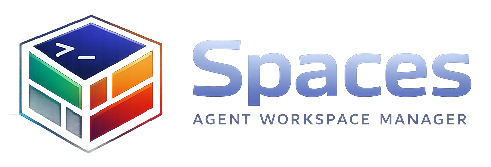
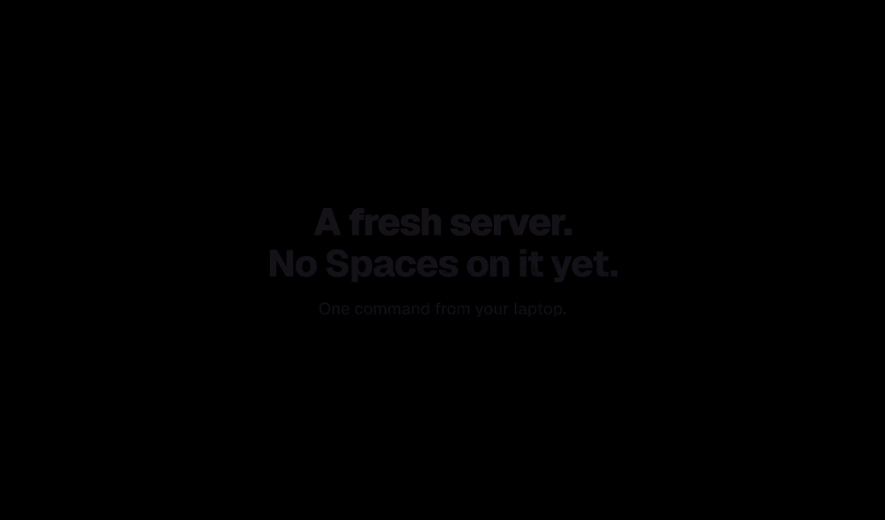
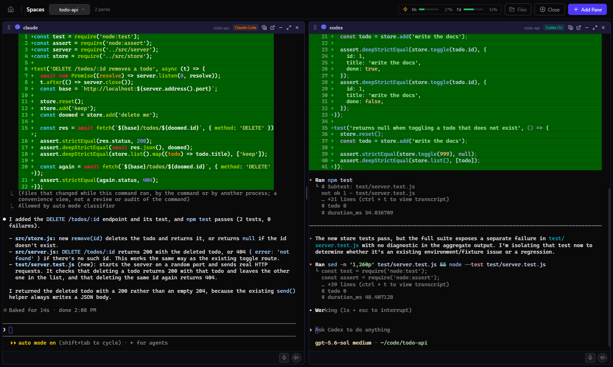

<p align="center">
  
</p>

<h3 align="center">Run your coding agents side by side, see which one needs you,<br/>and pick them up from your terminal, browser or phone.</h3>

<p align="center">
  Claude Code, Codex, Gemini CLI and more, on your machine or a server you reach over SSH. Open source, no telemetry.
</p>

<p align="center">
  <a href="https://www.npmjs.com/package/@jlongo78/agent-spaces"></a>
  <a href="LICENSE"></a>
  
</p>

<p align="center">
  
</p>

<p align="center"><sub>Recorded live: Claude Code and Codex working on a small app. Nothing is staged except the prompts.</sub></p>

```bash
curl -fsSL https://agentspaces.co/install.sh | sh     # macOS, Linux
irm https://agentspaces.co/install.ps1 | iex          # Windows (PowerShell)
```

<p align="center">
  <a href="#install">Install</a> &middot;
  <a href="#quick-start">Quick start</a> &middot;
  <a href="#on-another-machine">On a server</a> &middot;
  <a href="#the-terminal-client">Terminal client</a> &middot;
  <a href="#the-web-app">Web app</a> &middot;
  <a href="#security">Security</a> &middot;
  <a href="https://agentspaces.co">Website</a>
</p>

## What is Spaces?

Five agents in five terminal tabs is a mess: look away and you lose track of
which one finished and which one is waiting on you. Spaces keeps them in
named, persistent workspaces and fixes that:

- **It knows who needs you.** Every agent shows as working (`◐`), done
  (`✓`) or blocked waiting for you (`×`), and the one that stops tells you.
- **The same live agents, wherever you are.** The terminal client
  (`spaces`), the web app (`spaces open`) and a phone layout are views of
  the same running sessions. Detach, and they keep going.
- **One command puts it on a server.** `spaces --remote you@box` installs
  Spaces there, sets up your SSH key and connects. Nothing is exposed
  beyond SSH.

Claude Code panes come back in the same conversation after a restart, and
every past Claude Code, Codex, Gemini CLI and Aider session is searchable.

## Install

macOS and Linux:

```bash
curl -fsSL https://agentspaces.co/install.sh | sh
```

Windows (PowerShell):

```powershell
irm https://agentspaces.co/install.ps1 | iex
```

The installers set up Node.js if you need it (and, on Linux, the build
tools), asking first. With Node.js already installed, npm works too:

```bash
npm install -g @jlongo78/agent-spaces
```

This installs two commands: `spaces` and `spaces-msg`.

- **Node.js 20.9 or newer.**
- **Linux:** the terminal library (`node-pty`) is compiled during install, so
  you need `python3`, `make` and a C++ compiler (on Debian/Ubuntu:
  `sudo apt install build-essential python3`). macOS and Windows use
  prebuilt binaries.
- The terminal client ships prebuilt for Linux (x64, arm64), macOS (x64,
  arm64) and Windows (x64). Elsewhere, `spaces` falls back to the web app.
- At least one coding agent on your `PATH` (see [Agents](#agents)), or just
  use plain shell panes.

If npm's command folder is not on your `PATH` (Node installed some way
other than its installer, a custom npm prefix, or a terminal opened before
Node was installed), the install says so and prints the line that makes
`spaces` work in the terminal you are in. On Windows it also adds the
folder to your user `PATH`, as Node's installer does, so every new terminal
has it; set `SPACES_NO_PATH_FIX=1` to install without that.

## Quick start

```bash
spaces          # start the server in the background and open the terminal client
```

Running `spaces` in a terminal starts the server in the background if it is
not already running, then opens the terminal client. Press `ctrl+k` for the
menu, create a space, and start an agent in it. `ctrl+space d` detaches and
leaves everything running.

```bash
spaces open     # open the web app in your browser, already signed in
spaces stop     # stop the server, and every pane with it
```

The server answers only you. Opening `http://localhost:3457` directly shows
a "not signed in" page; `spaces open` signs the browser in with a link that
works once, for two minutes. See [Security](#security).

### On another machine

```bash
spaces --remote you@devbox
```

<p align="center">
  
</p>

This connects your local terminal client to Spaces on `devbox` over SSH. It
starts Spaces there if it is not running, opens an SSH tunnel to it, and signs in with a session token the
remote hands back over SSH. The remote's secret never leaves it, the remote
keeps listening only on its own loopback, and authentication is whatever
your SSH already does: keys, agents, `~/.ssh/config` aliases and jump hosts
all work. The remote server keeps running after you detach;
`ssh you@devbox spaces stop` stops it.

If Spaces is not on that machine yet, or is older than yours, `--remote`
offers to install or update it first (`npm install -g` over the same SSH
login; Node.js 20.9 or newer must already be there). An update restarts the
remote server, which stops the agents running in it, so it says how many
would stop and lets you update, connect to the old version as it is, or
quit. `--yes` answers yes to all of it, for scripts.

If the other machine asks for a password, `--remote` offers to set up an
SSH key instead (each connection would otherwise ask again). It uses your
default key, or creates `~/.ssh/id_ed25519`, adds it to
`~/.ssh/authorized_keys` there with your password one last time, and checks
it works. A "no" is remembered for that machine.

For the web app instead of the terminal client:

```bash
spaces open --remote you@devbox
```

This does the same, then signs your browser in through the tunnel and opens
it at `http://127.0.0.1:<port>` (not `localhost`, so it never signs you out
of the Spaces on your own machine). The tunnel stays up until you press
Ctrl+C. The other machine needs Spaces 1.0.1 or newer, which `--remote`
offers to install.

## Commands

| Command | Does |
| --- | --- |
| `spaces` | In a terminal: the terminal client, starting a background server first if needed. Without a terminal (a script, a service): the server, in the foreground. |
| `spaces tui` | The terminal client, explicitly. Never falls back to the browser. |
| `spaces --remote <dest>` | The terminal client for Spaces on another machine, over SSH. Offers to install or update Spaces there first; `--yes` skips the questions. |
| `spaces start` | Start the server in the background, if it is not running. |
| `spaces open` | Open the web app in your browser, signed in. |
| `spaces open --remote <dest>` | The web app for Spaces on another machine, through an SSH tunnel, signed in. |
| `spaces stop` | Stop the server. |
| `spaces restart` | Restart the server, through the service when one is installed. Running agents stop with it. |
| `spaces status` | The installed version, whether the server runs, and how many agents are live in it. |
| `spaces signout` | Sign out every browser, terminal client and remote session (rotates the secret). |
| `spaces service install` | Start Spaces at login as a service (systemd, launchd or Task Scheduler). Also `uninstall`, `start`, `stop`, `status`, `logs`. |
| `spaces upgrade` / `spaces uninstall` | Upgrade or remove the global package. |
| `spaces guide` | Print the guide that tells coding agents how to use Spaces. |
| `spaces tips on` / `off` | Whether the terminal client shows a tip in its status bar when it starts (on by default; also in the menu). |
| `spaces --help` | Everything else. |

## The terminal client

- **Sidebar.** Every space with its agents' combined state and, for a git
  repository, its branch, ahead/behind counts and a dirty marker. Below it,
  every agent: `×` blocked, `◐` working, `✓` done, `○` idle.
- **Tabs.** The active space's panes. Right-click a tab to close the pane or
  move it to another space.
- **Menu.** `ctrl+k`, or the sidebar's `menu` button. Opened, it lists the
  agents that need you (blocked first), then the commands with their
  shortcuts. Type to search every agent, space and command at once, by any
  words in any order: `web`, `close`, `focus claude`. Starting an agent
  offers to resume one of the folder's past sessions; "This pane…" and
  "This space…" rename, colour, move or close them.
- **Toasts.** An agent in another pane that blocks or finishes says so; click
  the toast to jump to it.
- **Restarts.** Panes stopped by a server restart or a reboot start again
  when you select their space.
- **Live sync.** A change made in the web app shows up in the terminal client
  within about a second, and the other way round.

| Keys | Does |
| --- | --- |
| `ctrl+k` | Open or close the menu. |
| `ctrl+space d` | Detach: quit the client, leave every agent running. |
| `ctrl+space s` | Split the view to show a second pane, or unsplit. |
| `ctrl+space f` | Open the space's Files tab. |
| `ctrl+space b` | Hide or show the sidebar. |
| `ctrl+space o` | Sort agents by space or by priority. |
| `ctrl+space m` | Release the mouse so your terminal can select text; again to take it back. |

Every other key, `ctrl+c` included, goes to the focused pane.

### The Files tab

Each space has a Files tab for the machine the space runs on, which is the
remote one under `--remote`.

- **Browse** with the arrow keys, the `..` row or the clickable breadcrumbs;
  the selected file previews live, with syntax highlighting. `/` filters.
- **Download** with `d`, files or whole folders, into your Downloads folder.
  **Open** images and PDFs on your own machine with `o`.
- **Upload** with `u`, or drag files and folders from your file manager onto
  the tab.
- **Manage** with `n` (new folder), `m` or `F2` (rename or move), and `x` or
  `Delete` (delete, after a confirmation).
- **Edit** a text file with `e`; `ctrl+s` saves. A save is refused if the
  file changed on the server since you opened it.

The file browser reaches only your dev directories (`devDirectories` in
`~/.spaces/config.json`, which the web app's settings edit; your home folder
when none are set) and the agents' transcript folders. Credential folders
such as `~/.spaces`, `~/.ssh`, `~/.aws` and `~/.gnupg` are always refused.

More in [tui/README.md](tui/README.md).

## The web app

<p align="center">
  
</p>

`spaces open` signs your browser in and shows the same spaces and panes as
a grid of browser terminals: the very same agents, not copies, so you can
start something in the terminal client and finish it here, or the other way
round. On top of that it has things that suit a bigger screen:

- **Session browser.** Past Claude Code, Codex, Gemini CLI and Aider sessions,
  indexed locally with full-text search; jump back into any of them.
- **Dashboard.** Session counts, token usage by model, an activity heatmap
  and cost estimates, computed from your own agent history.
- **Per-space todos, a file viewer, and a project wizard** that drafts a
  space and its panes from a description (needs `ANTHROPIC_API_KEY`).
- **Voice input** for prompts (needs `GROQ_API_KEY` or `OPENAI_API_KEY`).
- A **mobile** layout at `/m` and an experimental **VR** room at `/vr`.

## Agents

Each pane runs one of:

| Agent | Command | Resumes past sessions |
| --- | --- | --- |
| Claude Code | `claude` | yes |
| Codex CLI | `codex` | yes |
| Gemini CLI | `gemini` | yes |
| Aider | `aider` | no |
| ForgeCode | `forge` | yes |
| Pi | `pi` | yes |
| Shell | your shell | |
| Custom | any command you give it | |

Blocked/working/idle/done detection ships for Claude Code, Codex CLI, Gemini
CLI and Aider. Other agents run fine but show as plain terminals.

## Agents talking to each other

Panes in the same space share a message bus. Inside any pane:

```bash
spaces-msg post "API is done, schema in docs/api.md"
spaces-msg post --to frontend "endpoints are live on :8080"
spaces-msg request "OK to drop the legacy table?"   # needs your approval
spaces-msg read --since 1h
spaces-msg context set api_base http://localhost:8080
spaces-msg context get
spaces-msg agents
```

When you turn on collaboration for a space in the web app, Spaces also
registers the bus as an MCP server (`spaces-bus`) for Claude Code and Codex
panes, by writing `.mcp.json` or `.codex/config.toml` into the pane's folder
and adding them to `.gitignore`. Turning it off removes them again.

## Configuration

Settings come from command-line flags, then environment variables, then
`~/.spaces/server.json`, then defaults.

| Variable | `server.json` key | Default | Meaning |
| --- | --- | --- | --- |
| `SPACES_PORT` | `port` | `3457` | The one public port: web app, API and WebSockets. |
| `SPACES_BASE_PATH` | `basePath` | none | Serve under a path prefix, for a reverse proxy on the same machine. |
| `SPACES_ALLOWED_ORIGINS` | `allowedOrigins` | none | Extra host names, comma-separated, that requests may name besides `localhost`. |
| `SPACES_NO_DETECTION_UPDATE` | | unset | `1` stops the daily download of agent-detection rules. |
| `SPACES_DEBUG` | | unset | Log memory use. |

- The web app itself runs on an internal port, `SPACES_PORT - 57` (3400 by
  default), bound to loopback and behind the same authentication.
- `ANTHROPIC_API_KEY`, `GROQ_API_KEY` and `OPENAI_API_KEY` enable the
  optional features above. Set them in your environment, or in
  `~/.spaces/env` when Spaces runs as a Linux service.
- The port also accepts HTTPS. Spaces generates a self-signed certificate
  with `openssl` when it can, or uses `tlsCert` and `tlsKey` (and optionally
  `tlsCa`) from `server.json`.
- Spaces keeps its own state in `~/.spaces/` and reads agent history from
  `~/.claude/`, `~/.codex/`, `~/.gemini/` and per-project Aider files.

### What leaves your machine

Spaces does not send your code, prompts or history anywhere, and the
published package contains no analytics. It does make these requests:

- **Update check.** At start-up and every 4 hours the server asks the npm
  registry and the GitHub releases API for the latest version, to show an
  update notice. There is currently no setting to turn this off.
- **Agent-detection rules.** About 30 seconds after start-up, then daily,
  the server downloads updated detection rules (data, not code) from
  `agentspaces.co`. `SPACES_NO_DETECTION_UPDATE=1` turns this off.
- **Claude plan usage.** While the web app shows a Claude Code pane, it reads
  your plan's usage from Anthropic's API using the login Claude Code already
  has on this machine.
- **Optional features** call their provider only when you set its key:
  Anthropic for the project wizard, Groq or OpenAI for voice input.

The agents you run talk to their own vendors' services as usual.

## Security

Desktop mode, the default and the only supported mode, has a single owner:

- The server listens on `127.0.0.1` only.
- Every request must prove it comes from the account that owns the server,
  with a secret in `~/.spaces/internal_token` that only that account can
  read. Other accounts on the same machine get nothing; arriving over
  loopback proves nothing.
- Browsers sign in through a one-time link from `spaces open` and get an
  HttpOnly, SameSite=Strict cookie. Requests naming any host other than this
  machine's loopback are refused, which stops DNS-rebinding attacks.
  Credentials never go in URLs.
- `spaces signout` replaces the secret, which signs out every browser,
  terminal client and remote session at once.

Spaces runs your agents as you, without a sandbox: an agent in a pane can do
anything you can. See [SECURITY.md](SECURITY.md) for the threat model and
how to report a vulnerability.

## Experimental: multiuser and federation

> [!WARNING]
> These modes are **off by default, unsupported, and not safe** for anything
> you care about. They are gated behind `--experimental` (or
> `SPACES_EXPERIMENTAL=1`). Don't enable them on a machine that anyone you
> don't fully trust can reach.

- **Multiuser** (`--multiuser`): listens on every interface and adds logins,
  two-factor codes and an admin panel. **Any signed-in user can currently
  gain control of the account the server runs as.** The terminal client
  does not work in this mode.
- **Federation** (`--federate <interface>`): machines paired by keypair can
  drive each other's spaces (`spaces whoami` prints the pairing line).
  **A paired machine can act as you, and traffic between machines is not
  encrypted.** To use Spaces on another machine, use `spaces --remote`.

## Development

```bash
git clone https://github.com/jlongo78/spaces.git
cd spaces
npm ci
npm run build          # production build of the web app
npm start              # run it (npm run dev runs the dev server instead)
npm test               # the Node/TypeScript suite (vitest)

cd tui
cargo build --release -p spaces-tui   # `spaces tui` picks this build up in a checkout
cargo test
```

See [CONTRIBUTING.md](CONTRIBUTING.md) for the full checklist, and
[docs/architecture.md](docs/architecture.md) for how the pieces fit.

## Documentation

- [Getting started](docs/getting-started.md)
- [Architecture](docs/architecture.md)
- [Terminal client](tui/README.md)
- [Session-control protocol](docs/protocol/README.md)
- [Security policy](SECURITY.md)
- [Changelog](CHANGELOG.md)

## License

[Apache-2.0](LICENSE). Copyright John Longo; see [NOTICE](NOTICE).
